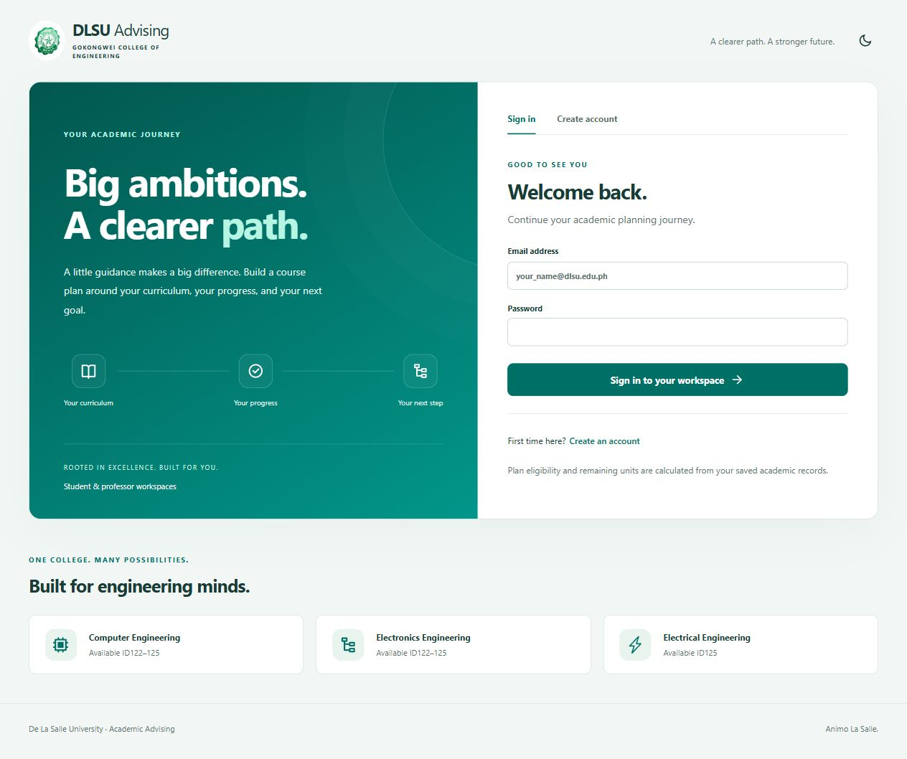
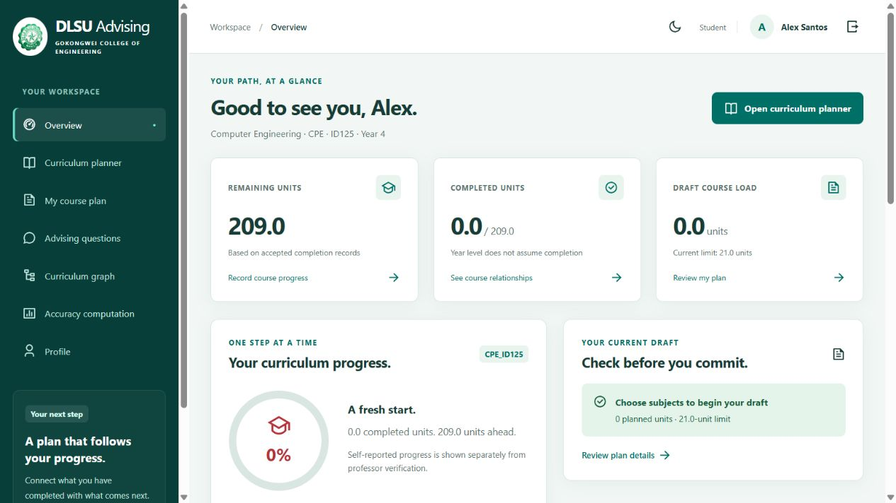
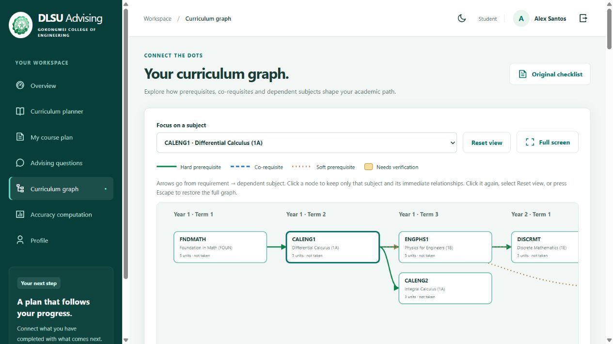
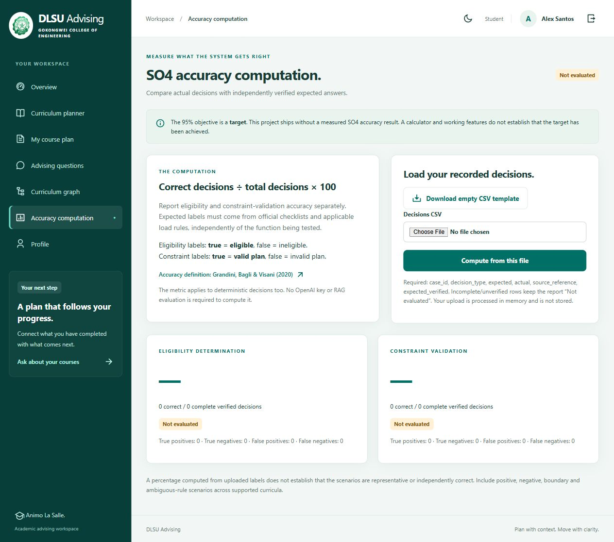
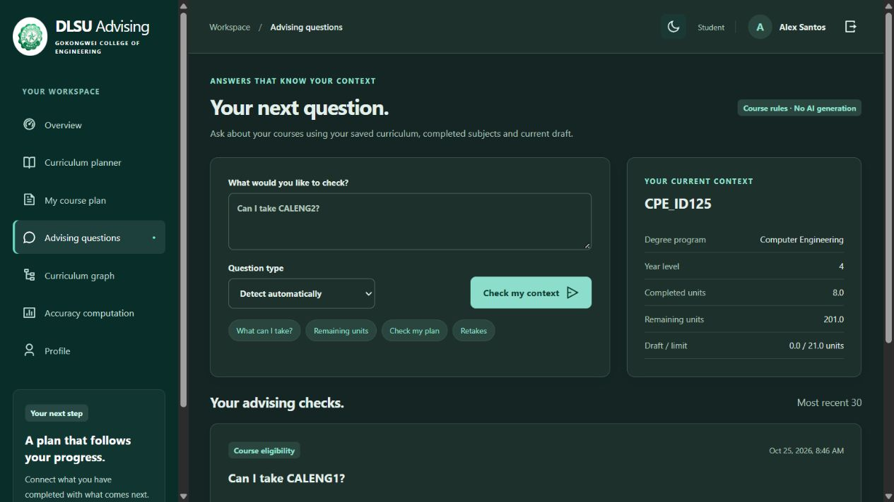
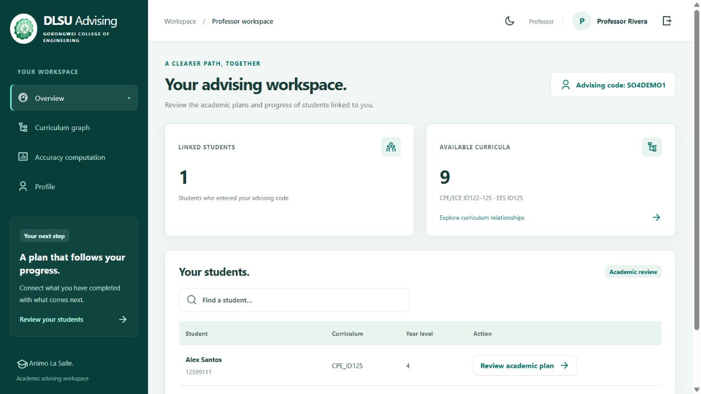

# DLSU Advising — SO4 Personalization

A separate, local **Student / Professor** workspace added to the supplied `thesis_academic_advisor-main.zip`. It implements student-specific curriculum planning, a MySQL-backed curriculum knowledge graph, deterministic prerequisite/load validation, query-type routing, and an accuracy calculator.

**Formal SO4 accuracy: NOT EVALUATED. No claim of 95% or higher accuracy is made.** No RAG tests or AI API calls were performed for this addition. The original RAG files remain separate and are not loaded by the SO4 launcher. An OpenAI key is not needed for the personalization module or accuracy computation.

This project is source-only and runs locally. It is not deployed or hosted. The existing deployed advising website, its GitHub repository, Aiven database and AuraDB graph are separate and were not changed by this project.

## What SO4 functionality is implemented?

| SO4 requirement | This application |
|---|---|
| Degree program and curriculum year | A student's selected curriculum scopes all course records and rules; CPE/ECE ID122–125 and EES ID125 |
| Completed courses | Bulk progress saving; completed/enrolled/failed states; no completion inferred from year level |
| Remaining units | Recomputed from actual saved completion records and accepted credit; new accounts at every year level start with full curriculum units |
| Query type | Explicit type selection or basic keyword detection for eligibility, prerequisite lookup, current-plan checks, retakes and remaining units |
| Curriculum knowledge graph | Course nodes + typed requirement edges stored in MySQL, loaded into Python adjacency maps, visualized interactively and used by the validator |
| Prerequisite and course-load constraints | Hard/co/soft/standing checks, flagged-rule handling, pending credit checks, unit totals, load limits, and revalidation before submission/academic approval |
| At least 95% accuracy | **Unmeasured.** Separate computation tools and blank decision templates are provided; formal ground truth and recorded academic results are still required |

The functional implementation is ready for inspection. This is not a declaration that the complete SO4 objective, its curriculum correctness or its numerical target has been independently achieved.

## Quick start on Windows

1. Install/start a **local MySQL server**. If using XAMPP, start its MySQL/MariaDB service and use its actual port and password. There is no SQLite fallback. Do not use the deployed website's database for this separate project.
2. Open this folder in VS Code. Double-click **`configure_so4.bat`** (or run it in the terminal).
3. The script creates `.venv-so4`, installs only `requirements-so4.txt`, and asks privately for your local MySQL connection. Press Enter to accept host `127.0.0.1`, port `3306`, username `root` and the **new separate** database name `dlsu_so4_personalization` when those values match your installation. Enter the password assigned to your local MySQL account; it is not an OpenAI key.
4. Settings are saved only in ignored `.env.personalization`. The setup adds `so4_` tables and seeds nine curricula into that separate database. It refuses unrelated existing tables and does not delete accounts/records.
5. Run **`start_so4.bat`** and open **http://127.0.0.1:5002/**. Keep its terminal open while using the app.
6. Create a Student or Professor account. Only those two roles exist; role assignment does not require a Super Admin.

Python 3.10+ is required. If `py` is unavailable, install Python from python.org and enable the Python launcher, or use the terminal setup below. A local MySQL password is entered privately, never committed to GitHub.

### Terminal setup (any OS)

```sh
python -m venv .venv-so4
# Windows: .venv-so4\Scripts\activate
# macOS/Linux: source .venv-so4/bin/activate
python -m pip install -r requirements-so4.txt
python configure_so4.py
python run_personalization.py
```

`SO4_PORT` changes the local port; the server binds only to loopback. The local configurator is idempotent and does not overwrite academic records. If you manually prepare `.env.personalization` from its example, create a new local database first and initialize it with:

```sh
python -m flask --app personalization.app:create_app init-db
```

The SO4 configuration uses **`SO4_DATABASE_URL`**, not the original RAG's database settings. These are intentionally separate schemas/connections. No old account databases, private keys, cloud configuration or existing website credentials are included in this repository or ZIP.

## Student walkthrough

* Choose a degree/curriculum, an eight-digit student number matching its ID prefix, and year level (including Other). Sign in with a `@dlsu.edu.ph` address. Every new account starts with no completed subjects, even in fourth year.
* Open **Curriculum planner**. Change several progress fields, then click **Save all progress** once. Remaining units, eligibility and recommendations use those saved records.
* Use **Choose equivalent / GE** for eligible slots. The selection retains slot units and awaits your linked professor's confirmation before it earns credit or satisfies prerequisites. LBYEC3F / LBYCPC3 / LBYCPCS is the corrected control-lab group. **LBYCPC4 is separate.** LBYCPA4 / LBYEC4A and earlier user-requested groups are preserved.
* Open **My course plan**, select subjects and save your draft. The feedback lists unmet requirements and excess units. Invalid drafts can be edited; they cannot be submitted as valid plans. The default 21-unit limit is a configurable demonstration setting, not an asserted institution-wide policy.
* Open **Advising questions** and ask “Can I take CALENG1?”, “What prerequisites for CALENG2?”, “Validate my plan”, “Which retakes do I have?”, or “How many remaining units do I have?”. An explicit type selector covers phrasing outside the small keyword router. These are rule-based replies from your saved academic context, not LLM/RAG answers.
* Open **Curriculum graph**. Click a course to focus on its direct prerequisites/dependents; deselect or reset to restore everything. Full screen, keyboard selection and a textual relationship table are available. Original checklist PDFs can be opened from the planner/graph.

## Professor walkthrough

* Create a Professor account and find your advising code in **Profile**.
* A student enters that code in their own Profile. You then see them in your linked-student list.
* Open a student's academic review page to inspect progress and plan validation; confirm reported progress, equivalent/GE credit and flagged/soft-rule interpretations with evidence notes; record an applicable approved load limit; or review a submitted plan.
* Hard prerequisites remain enforced. Approval of a submitted plan performs a new validation using current progress, relationships and load limit.

These are **academic reviews related to personalization**, not approvals for distributing user roles. There is no Super Admin, Administrator, role-management approval, security dashboard, MFA, SMTP/email verification, field-encryption module, appointment system or unrelated website feature suite. Basic password hashing, sessions, form tokens and ownership checks remain to support ordinary accounts; roles are self-declared for this local research workspace.

## The graph does not require Neo4j

`so4_courses` stores nodes and `so4_relationships` stores typed edges. `personalization/rules.py` constructs the incoming/outgoing adjacency maps. The **same graph** supplies the validator and diagram, so it is more than a visual chart.

* Solid green → hard prerequisite
* Dashed blue → co-requisite
* Dotted tan → soft prerequisite
* Amber node → needs verification

No Neo4j installation, Aura account, graph driver, GPU, Chroma store or OpenAI API key is required to run this addition. MySQL remains necessary for saving accounts, progress and graph records.

## Accuracy computation only — no 95% claim

The **Accuracy computation** tab accepts recorded expected/actual binary decisions and reports eligibility and constraint accuracy separately. The default and empty template display **Not evaluated**. Unverified/missing outcomes produce no headline percentage.

```text
Accuracy (%) = correct decisions / total evaluated decisions × 100
```

```sh
python -m personalization.accuracy --input evaluation/so4/decisions.template.csv
```

The blank template returns `not_evaluated`. A future independently verified academic decision set can be processed with `--input your-private-decisions.csv --output evaluation/so4/local-results/report.json`. No AI key is required. Merely running software tests or filling labels to match the implementation does not demonstrate the thesis accuracy target.

The formula is supported by Grandini, M., Bagli, E., & Visani, G. (2020), *Metrics for Multi-Class Classification: an Overview*, Section 2: https://doi.org/10.48550/arXiv.2008.05756. The citation supports the computation, not the choice or achievement of the 95% threshold.

Read [SO4 evaluation protocol](docs/SO4_EVALUATION.md) for case definitions, confusion matrices, boundary/negative cases, source verification and the difference between engineering checks and a formal accuracy experiment. `evaluation/so4/status.json` intentionally contains null measured results.

## Design

The interface carries forward the advising website's sidebar, dashboard cards, planner tables, bulk progress action, focused curriculum graph and light/dark mode, with the requested image's **teal `#02968A`**. Darker teal controls preserve readable white text. Familiar licensed Remix icons replace generated symbols. The interface includes keyboard focus, labels, responsive layouts, a graph relationship table, and two-second success toasts that pause on hover/focus. Signing out returns the front page to light mode.

## Engineering checks

```sh
python -m unittest discover -s tests -p test_rules.py -v
```

These synthetic checks verify rule handling, graph payloads, query routing and calculator arithmetic. Optional `tests/test_app.py` checks MySQL routes only when `SO4_TEST_DATABASE_URL` points to a dedicated loopback `so4_test_` database on an isolated port. It refuses ports 3306/3307 and unrelated database names. **Their pass count/rate is not SO4 academic accuracy.** No RAG tests are run by this suite.

## Repository layout and upstream history

```text
personalization/               New SO4 app, MySQL models, graph/validator, query router, accuracy tools, teal UI
run_personalization.py         Local-only SO4 launcher (port 5002)
configure_so4.py / *.bat        Separate local MySQL setup and start scripts
requirements-so4.txt           Lightweight SO4 dependencies
personalization/data/          Nine public curricula, GE suggestions and review provenance
personalization/static/vendor/ Existing licensed icon subset
personalization/templates/     Student/Professor screens
evaluation/so4/                Empty decision template + not-evaluated status
tests/                         Synthetic engineering checks only
docs/                          Design, evaluation protocol, attribution and original README
DATA/, demo/, PROTOTYPE_1/, ... Original supplied RAG research files, not loaded by SO4
```

This is a separate public repository derived from the supplied ZIP. The original repository at https://github.com/tayshbokki/thesis_academic_advisor is untouched. Original research files and results are retained with provenance in `docs/upstream-manifest.json`; the original README is at `docs/UPSTREAM_README.md`. Its historical objective numbering called latency/throughput “SO4”; this addition uses the **personalization SO4 quoted by the user**. Old RAG benchmark numbers do not establish the new module's accuracy.

See [SO4 design and boundaries](docs/SO4_DESIGN.md) and [source/asset attribution](docs/ATTRIBUTION.md). No license for upstream code/documents is invented here; retain and respect original authorship and applicable permissions.

## Screenshots

These show synthetic local demonstration accounts, not real student records.













Validation performed for this addition: 21 synthetic engineering tests passed against an isolated temporary local MySQL server; browser checks covered sign-in, bulk progress updates, remaining-unit recalculation, query routing, graph focus/reset, dark mode and logout-to-light behavior. These are implementation checks, **not a measured SO4 academic accuracy result**. No RAG test or model API call was performed.
