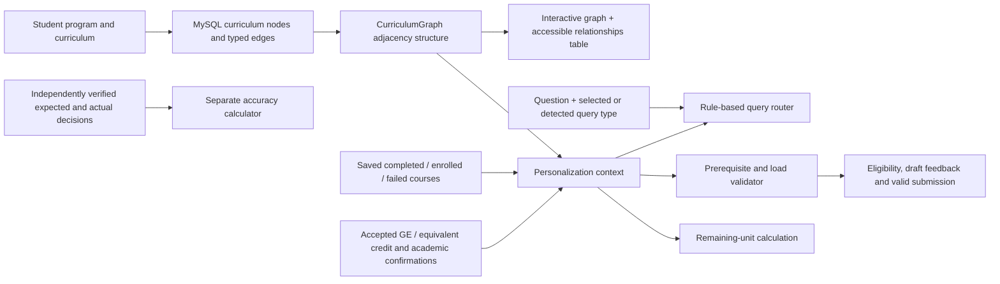

# Personalization design and scope

This addition implements the functional personalization path in the SO4 supplied by the thesis authors:

> To develop and integrate a personalization module that leverages student-specific attributes (degree program, curriculum year, completed courses, remaining units, and query type) together with a curriculum knowledge graph to automatically enforce prerequisite and course-load constraints, targeting at least 95% accuracy in eligibility determination and constraint validation across all test scenarios.

**The target is not a measured result.** The functional implementation is present; the formal independently verified SO4 evaluation has not been performed. RAG is not evaluated or called by this application.

## Data flow

## Student-specific attributes

* **Degree program/curriculum year:** a supported curriculum key selects that student's actual course nodes and relationships. CPE and ECE ID122–125 and EES ID125 are selectable. The student-number prefix must match the selected ID, and the number contains eight digits.
* **Completed courses:** explicit progress records drive eligibility. First, second, third, fourth and Other year levels all start with zero completed courses. Completion is never inferred from standing.
* **Remaining units:** total curriculum units minus completed slot units with accepted credit. Zero-unit subjects still participate in prerequisite checks. A pending/rejected alternative does not earn units or satisfy prerequisites. Reported progress and professor verification are displayed separately.
* **Query type:** the user can explicitly choose eligibility, prerequisite lookup, current-plan validation, retake or remaining-unit queries, or use a small English/Filipino keyword router. This is deterministic routing, not a trained intent classifier. Unknown phrasing requests clarification/type selection. Each saved answer records the curriculum, completed courses, remaining units and query type used.

## A knowledge graph without Neo4j

`so4_courses` contains course nodes. `so4_relationships` contains typed directed edges from a requirement code to its dependent course. `personalization/rules.py` builds incoming/outgoing adjacency maps and exposes a graph payload. The **same graph** drives both validation and visualization. It is not a static screenshot or an unrelated drawing.

The diagram labels hard prerequisites (solid green), co-requisites (dashed blue), soft prerequisites (dotted tan), and unresolved/flagged nodes (amber). Focus mode shows a selected node and its immediate incoming/outgoing relationships. Reset or deselection restores the full graph. A textual relationship table provides the same information. External references stay visible and flagged rather than being silently dropped.

There is no Neo4j driver, Aura connection, APOC, Cypher or graph-server dependency in this addition. MySQL holds the graph's structured records; Python performs the traversals/checks; browser-native SVG draws it.

## Validation policy

* **Hard prerequisite:** must be completed with accepted credit. It cannot be waived through the professor interface.
* **Co-requisite:** must be completed, currently enrolled, or selected alongside the target. Selecting a co-requisite does not bypass that co-requisite's own rules.
* **Soft prerequisite:** a passed prerequisite satisfies it. Otherwise, the default is conservative review of prior enrollment/applicable policy, with a student-specific professor confirmation and reference. This is a configurable research workflow requiring institution-specific verification, not an assertion that every soft prerequisite must be passed.
* **Standing:** confirmed numeric year-level requirements are checked; Other does not invent a numeric standing.
* **Unresolved rules:** fail closed for submission and remain flagged. Confirming a parsed entry does not make an unknown/missing hard requirement disappear.
* **Course load:** sum selected curriculum slot units and compare with the configured default or a recorded professor-approved limit. The default of 21 is a demonstration setting, not a certified DLSU-wide limit or a per-term printed checklist total. Professors record the applicable policy/reference for changes.
* **Draft versus submission:** an invalid draft can be saved for editing. A nonempty draft must pass the rules and load checks before submission. Professor approval revalidates the submitted course list against current student context; old valid results are not blindly reused.

GE selections preserve one original slot and its units. A subject cannot fill two slots in a submitted draft. Equivalent groups carried forward from the user-specified website are offered only for matching CPE/ECE ID122–125 slots/units and require professor confirmation when a student selects an alternative:

| Group | Units |
|---|---:|
| FDCNSYS / FDCONSY / FDCONSYS / FEECONS | 3 |
| DSIGPRO / SIGDISC | 3 |
| LOGDSGN / CIRLOGI | 3 |
| LBYEC3A / LBYEC3B | 1 |
| LBYCPA4 / LBYEC4A | 1 |
| LBYEC3F / LBYCPC3 / LBYCPCS | 1 |

**LBYCPC4 is a separate course. LBYEC3C is not in the equivalency group.** These user-requested groups and GE suggestions are not claimed to be institution-certified equivalencies; academic confirmation remains necessary.

## Roles and boundaries

Only Student and Professor roles exist in the SO4 app. Users select their role at registration. A student links to a professor using that professor's advising code. A professor sees only linked students and can review progress, alternative credit, soft-policy/flagged-entry confirmations, load limits and submitted plans. Changing professor resets professor-specific confirmations and limit/credit/progress-verification decisions.

There is no Administrator/Super Admin, role-assignment approval, role-switching management, MFA, SMTP, email verification/reset workflow, security dashboard, field-encryption module, appointment scheduler or chat-project system in the SO4 application. Ordinary password hashing, session forms and ownership checks remain as basic account behavior; this is a self-declared-role local research application, not a production identity-verification system.

## Curriculum provenance and unresolved interpretation

`personalization/data/curricula.json` carries forward the structured public checklist catalog from the existing website, for the nine supported curricula. Original PDFs remain in the ZIP's `DATA/raw_data/` directory and are linked from the UI. Records retain source filenames, page references, warnings and verification flags. `checklist_review.json` records the previous parsing corrections; it is provenance, not evidence that an independent academic evaluator has approved every rule.

Treat remaining ambiguities, suggested GE suitability, the user-requested equivalency groups and actual load limits as items for verification before a formal accuracy claim. The system implements checks against the loaded rules; correct academic outcomes still depend on correct source interpretation.

## Separation from original RAG

The original demo and evaluation scripts remain in their original paths. `run_personalization.py` imports only the new package and light web/database dependencies. It does not import OpenAI, Chroma, transformers, embeddings, rerankers, the RAG demo or RAG evaluation scripts. No RAG computations, models or API calls were run to validate this addition. The existing RAG's SQL schema/database is separate from the prefixed `so4_` tables in a new local database. Future integration can call the deterministic validator and pass its results to retrieval/generation; it has not been implemented here.

The original README mapped “SO4” to latency/throughput. Its preserved copy at `docs/UPSTREAM_README.md` describes the historical RAG experiment numbering. The personalization objective quoted above is the objective used by this addition.
